<p align="center">
  
</p>

# cipher-mem

Persistent Markdown vault parser, vector indexer, and cosine similarity engine.

Written in pure Go. Continuously watches an Obsidian vault or directory of Markdown files via `fsnotify`, extracts semantic chunks and wikilinks (`[[link]]`), and provides sub-millisecond vector similarity search for downstream agents.

Looking for a plain-English, non-technical summary? See [EXPLAINER.md](EXPLAINER.md).

---

## Capabilities

* **Filesystem Watcher**: Watches target directories for filesystem mutations, triggering immediate chunk re-indexing and pruning deleted documents.
* **Graph and Link Extraction**: Resolves wikilinks into a directed knowledge graph.
* **Vector Cosine Similarity**: In-memory vector store backed by JSON and WAL persistence.
* **IPC Transport**: Operates over HTTP port `8083` or Unix domain socket `/tmp/cipher/mem.sock`.

---

## Build

```bash
go build -o cipher-mem .
```

---

## Usage

```bash
./cipher-mem --vault ./sample_vault --port 8083 --socket /tmp/cipher/mem.sock
```

### Endpoints

#### `POST /api/search`

Cosine similarity query against indexed vault chunks.

Request:
```json
{
  "query": "Execution Timeout Runaway Loop",
  "top_k": 3
}
```

Response:
```json
{
  "results": [
    {
      "chunk": {
        "file": "INC-1792868105-resolution.md",
        "title": "Incident Resolution",
        "content": "Execution timeout runaway loop in sandbox..."
      },
      "similarity": 0.823
    }
  ],
  "latency_ms": 0.77
}
```

#### `GET /api/graph`

Returns node and edge definitions for force-directed graph visualization.

---

## License

MIT License. Copyright (c) 2026 Shlok Tiwari.
